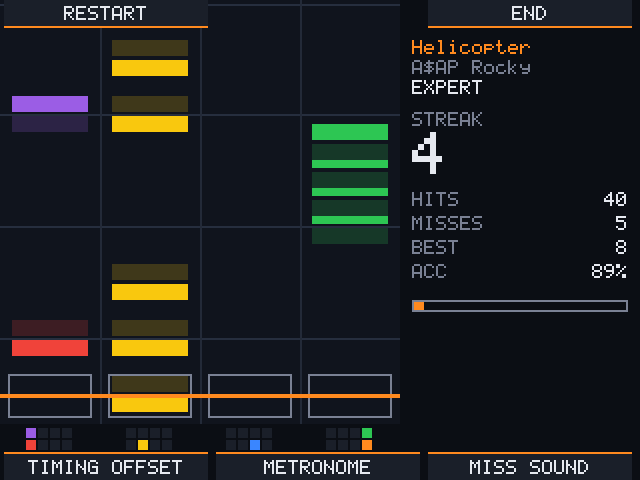
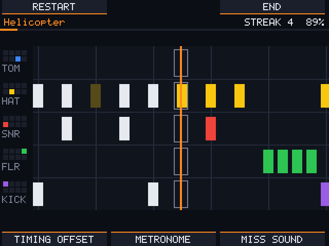
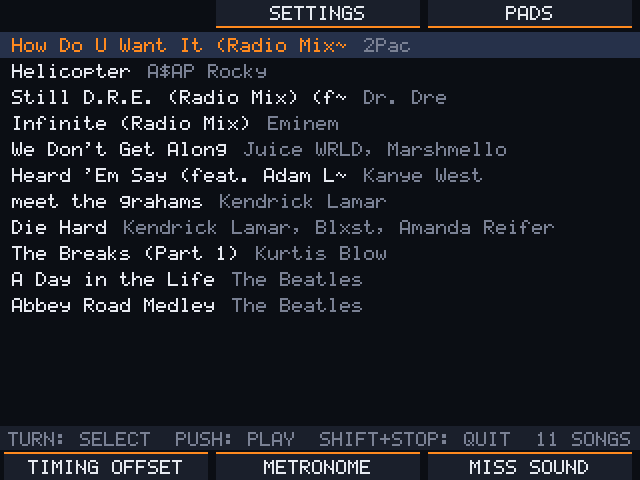
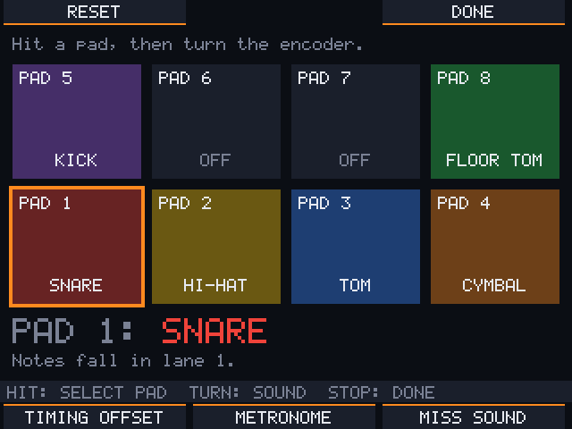

# Beat-Train for the MPC Sample

A drum game for the Akai MPC Sample. Pick a song, and its drum part comes down a
note highway on the screen; play it on the pads. You get hits, misses, streaks
and accuracy, and a miss turns the drums in the song down.

  
  

  
  

Beat-Train runs from the SD card. Nothing on the MPC is changed: take the card
out, or power off, and the MPC is exactly as before.

> Unofficial and not affiliated with Akai. Use at your own risk.

## What you need

- An **Akai MPC Sample with firmware 1.3.0.x**. To check: without a card, press
  SHIFT + PAD 8 (MIDI Config); the version is at the top right.
- A **microSD card formatted as exFAT**, just for Beat-Train. A card holds only
  one start-up program, so not the card you use for SampQOL OS.
- **Songs** in Clone Hero format (see [Songs](#songs)).

## Install

1. Download `beattrain-mpc-sample.zip` from
   [Releases](../../releases/latest) and unzip it.
2. Copy both folders, `autorun` and `BeatTrain`, to the top level of the card.
3. Put your songs into `BeatTrain/Songs/` on the card, one folder per song.

## Start and quit

- Put the card in while the MPC is running, or switch the MPC on with the card in.
  The MPC asks **"Start Beat-Train?"**: **B1** starts it, **B3** keeps the MPC.
- Starting closes the MPC software. **Save your work first.**
- **SHIFT + STOP** quits Beat-Train and the MPC software comes back.
- **POWER** asks "Do you want to shut down?": **B3** saves and switches the MPC off,
  **B1** goes back.

If the MPC stops at **0 %** while loading after you switch it on, the question is
hidden behind the loading screen: press B1 (Beat-Train) or B3 (MPC).

## Playing

| Control | What it does |
|---|---|
| Encoder | turn to choose a song or difficulty, push (or PLAY) to start |
| B1 B2 B3 | what the bar at the top of the screen says above each button |
| Pads 1–4 | snare (red), hi-hat (yellow), tom (blue), cymbal (orange) |
| Pads 5–8 | kick, –, –, floor tom (green) |
| PLAY | pause and resume |
| STOP | end the song and see the results; in menus: back |
| K1 | timing offset: turn it if your hits feel early or late |
| K2 | metronome volume (all the way down = off) |
| K3 | miss sound volume (all the way down = off) |
| MAIN VOLUME | volume |
| SHIFT + FADER | song speed for practising, 50–100 %, at the same pitch |

The pads light up in their drum colour. Each note's upper half belongs to the
upper row of pads, the lower half to the lower row.

Under **Highway** in the settings you choose how the notes run: down four lanes as
above, down one lane per pad (*vertical by pad*), or from right to left with one row
per pad (*horizontal*). Small maps of the pads under each lane, or left of each row,
show which pad to hit. **Strike line** moves the line you hit on away from the edge, a quarter,
a third or half way in, so you see more of the notes you have just played.

**Settings** (B2 in the song list): timing offset, hit window, metronome, miss
sound, highway direction, strike line, and a volume for each part of the song
(drums, bass, vocals…). B2 opens them during a song too: the song pauses, and DONE
takes you back after a 3-2-1.

**Pads** (B3 in the song list): hit a pad, then turn the encoder to choose its
drum. B1 puts all pads back to the defaults.

Settings and pads are saved on the card in `BeatTrain/settings.json`.

## Songs

Each song is a folder in `BeatTrain/Songs/` with:

- `song.ini`: title, artist and so on,
- `notes.mid` or `notes.chart`: the charts, with a drum part,
- the audio: `song`, and optionally `drums`, `bass`, `guitar`, `rhythm`,
  `vocals`, `keys` and `crowd`, as `.mp3`, `.ogg` or `.wav`.

Song folders made for Clone Hero work as they are, and many are shared online.
Rock Band packages (`_rb3con`, `.mogg`) and Opus audio don't work. Convert those to
a Clone Hero folder first, for example with Onyx.

No chart for a song you like? [Trackyard](https://github.com/drose030/trackyard)
makes one from the audio (MP3, WAV, OGG or FLAC) on your computer, lets you fix it in an editor and
saves it as a song folder for the card.

## If something goes wrong

- **No question when you put the card in:**
  - Check that the card is exFAT and that the `autorun` folder sits at its top level.
  - Check that the firmware is 1.3.0.x.
  - Don't change the files in `autorun`: the MPC checks them.
- **"No songs found":** the song folders must be in `BeatTrain/Songs/`, each
  with a `song.ini`.
- **The MPC hangs:** hold POWER until it switches off, then remove the card.
- **Logs:** `autorun/logs/` on the card shows what happened at the last start.

## Updating

Replace the `autorun` folder on the card with the new one. Your songs and
settings in `BeatTrain` stay as they are.

## Together with other programs

[mpc-boot-thingy](https://github.com/garrettjwilke/mpc-boot-thingy) puts a boot
menu on the card, so Beat-Train can sit next to other MPC programs such as
SampQOL-OS. Boot thingy takes over the card's `autorun` folder, so install it
first as its README describes, then add `beattrain-mpc-sample.zip` as an app.
Your songs stay in `BeatTrain/Songs/` at the top of the card.

This is not tested with Beat-Train yet. If you try it, please say how it went in
the [discussions](https://github.com/drose030/beat-train-mpc-sample/discussions).

## More

- How it is built and how it works inside: [docs/development.md](docs/development.md)
- Audio decoding uses [minimp3](https://github.com/lieff/minimp3) (CC0) and
  [stb_vorbis](https://github.com/nothings/stb) (public domain).
- License: [MIT](LICENSE). The bundled decoders keep their own licences.
- Thanks to [virtual-mpc-sample](https://github.com/orrpunk-art/virtual-mpc-sample)
  and [mpc-sample-root-ssh](https://github.com/orrpunk-art/mpc-sample-root-ssh) for
  the hardware research the port builds on.
